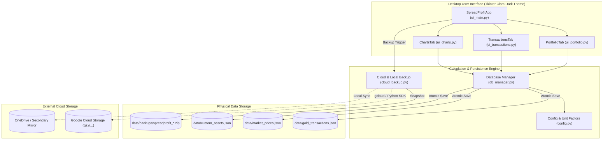

<div align="center">



# SpreadProfit

### *Personal Precious Metals & Multi-Asset Portfolio Tracker | Moving Average Cost Basis Engine*

[](https://www.python.org/)
[](LICENSE)
[](https://microsoft.com)
[](https://docs.python.org/3/library/tkinter.html)
[](https://matplotlib.org/)
[](https://cloud.google.com/storage)

<p align="center">
  <b>A private, high-performance, offline-first personal portfolio management application engineered specifically for physical precious metals (Gold, Silver, Platinum) and multi-asset wealth tracking.</b>
</p>

[Key Features](#key-features) |
[Architecture](#system-architecture) |
[Quickstart](#quickstart--installation) |
[Cloud Backup](#google-cloud-storage-backup) |
[Building Standalone Binary](#building-portable-executable) |
[License](#license)

</div>

---

## Overview

Most retail investors who accumulate physical gold, silver, or precious assets face distinct tracking challenges:
1. **Disparate Bullion Units**: Transactions occur in non-metric traditional units (e.g., Vietnamese *Tael / Luong*, *Chi / Mace*, fractional *0.1-5 Chi*) alongside international metrics (*Troy Ounce*, *Gram*).
2. **Complex Cost Basis**: Staggered purchases over months or years require an accurate **Moving Weighted Average Cost (MAC)** basis to correctly compute true capital outlays and real-time PnL.
3. **Privacy Concerns**: Storing exact physical metal holdings and net worth on third-party cloud SaaS introduces privacy and security risks.

**SpreadProfit** solves these challenges with a clean, offline-first desktop application that keeps **100% of data local**, provides high-precision moving average accounting, delivers rich visual charts, and offers optional one-click backups to your own **Google Cloud Storage (GCS)** or OneDrive bucket.

---

## Key Features

### Portfolio Management & Financial Analytics
* **Moving Weighted Average Cost (MAC) Engine**: Automatically computes cost basis chronologically across staggered buy and partial sell transactions.
* **Dual-Region Unit Conversions**: Seamlessly translates between traditional bullion units (*Tael*, *Chi*, fractional *Chi*) and international standards (*Troy Ounce*, *Gram*) using standard Troy conversion ratios ($1\text{ Tael} = 1.2057\text{ oz troy}$).
* **Real-Time Unrealized PnL & ROI**: Instant valuation cards showing total invested capital, current portfolio market value, net unrealized gain/loss, and ROI %.
* **Benchmark Market Quotes**: Quick-update panel to set current market buy/sell prices by category (*Gold*, *Silver*) with automatic unit parity.

### What-If Scenario Simulator
* Forecast gross liquidation proceeds, net dollar profit, and target ROI % before executing any physical bullion sell transaction.

### Embedded Visual Analytics (5 Subplots)
1. **Asset Allocation Donut Chart**: Breakdown of portfolio value by asset category or holding.
2. **Cost vs Value Bar Chart**: Comparison between historical invested capital and current market valuation.
3. **Cumulative Purchase Trend Line**: Capital inflow timeline across historical transaction dates.
4. **Cost Basis vs Benchmark Price**: Side-by-side comparison of purchase cost basis vs current spot prices.
5. **Net PnL Horizontal Bar Chart**: Color-coded profit and loss distribution across individual holdings.

### Privacy & Cloud Synchronization
* **100% Local Offline Storage**: Stored as clean JSON in `data/` adjacent to the binary or `%APPDATA%/spreadProfit`.
* **Atomic Writes**: Uses temporary swap writes to guarantee zero database corruption during unexpected power outages.
* **Google Cloud Storage (GCS) Sync**: Integrated `cloud_backup.py` module creates timestamped snapshots and uploads to your private Google Cloud Storage bucket.
* **Multi-Format Portability**: Full support for importing and exporting portfolio records to **Microsoft Excel (`.xlsx`)**, **CSV**, and **JSON**.

---

## System Architecture



---

## Quickstart & Installation

### Prerequisites
* **Python**: 3.11, 3.12, or 3.13 (64-bit recommended)
* **Operating System**: Windows 10 / Windows 11 (Supports High-DPI scaling)

### 1. Clone the Repository
```bash
git clone https://github.com/dophuhung/spreadProfit.git
cd spreadProfit
```

### 2. Set Up Virtual Environment (Recommended)
```bash
python -m venv .venv
.venv\Scripts\activate
```

### 3. Install Dependencies
```bash
pip install -r requirements.txt
```

### 4. Launch the Application
```bash
python app.py
```

---

## Google Cloud Storage Backup

SpreadProfit includes native snapshot generation and Google Cloud Storage (GCS) synchronization via `cloud_backup.py`.

### 1. Configure Your Google Cloud Bucket
You can specify your GCS bucket using an environment variable or via `data/cloud_config.json`:

**Via Environment Variable (PowerShell):**
```powershell
$env:GCS_BACKUP_BUCKET = "gs://my-spreadprofit-backups"
```

**Via Configuration File (`data/cloud_config.json`):**
```json
{
  "gcs_bucket": "gs://my-spreadprofit-backups"
}
```

### 2. Authenticate Google Cloud CLI
Ensure your Google Cloud credentials are authenticated:
```bash
gcloud auth login
gcloud auth application-default login
```

### 3. Run Backup Command
* **From the GUI**: Click the **`Cloud Backup`** button in the top navigation bar.
* **From the Terminal / CLI**:
  ```bash
  python cloud_backup.py
  ```

Every backup creates:
1. A consolidated JSON snapshot: `data/backups/spreadprofit_snapshot_<timestamp>.json`
2. A compressed physical file archive: `data/backups/spreadprofit_backup_<timestamp>.zip`
3. A synchronized upload to your configured GCS bucket path: `gs://<bucket>/spreadprofit/backups/`
4. A mirrored local replica in `OneDrive\SpreadProfit_Backups` (if Microsoft OneDrive is active).

---

## Building Portable Executable

To compile a standalone, single-file Windows executable (`SpreadProfit.exe`) that runs on any machine without installing Python:

```bash
pip install pyinstaller
python build_exe.py
```

### Build Artifacts
Upon completion, the script generates:
* `dist/SpreadProfit.exe`: Self-contained executable with embedded seed data.
* `dist/SpreadProfit_portable/`: Complete portable folder (executable + data directory + quickstart guide).
* `dist/SpreadProfit_portable.zip`: Compressed archive ready to transfer to a flash drive or other Windows computers.

---

## Running Automated Tests

SpreadProfit includes a comprehensive suite of unit tests validating cost basis math, unit parity, atomic writes, and UI initialization:

```bash
python -m unittest discover -s tests -p "test_*.py"
```

---

## Repository Structure

```
spreadProfit/
├── app.py                      # Application launcher with High-DPI initialization
├── app.spec                    # PyInstaller bundle specification
├── app_icon.ico                # Windows application icon
├── app_icon.png                # Multi-platform PNG application icon
├── build_exe.py                # Standalone binary compiler script
├── cloud_backup.py             # Google Cloud Storage & local snapshot service
├── config.py                   # Typography, theme palette, and unit factors
├── db_manager.py               # JSON database manager and MAC portfolio engine
├── LICENSE                     # MIT Open-Source License
├── README.md                   # Project documentation and visual guides
├── requirements.txt            # Production runtime dependencies
├── ui_charts.py                # Matplotlib visual analytics tab
├── ui_main.py                  # Tkinter root window and theme manager
├── ui_portfolio.py             # Portfolio KPI cards and what-if simulator
├── ui_transactions.py          # Transaction entry, calendar, and data I/O
├── data/                       # Local persistent database directory
│   ├── custom_assets.json      # User-defined assets
│   ├── gold_transactions.json  # Transaction ledger
│   └── market_prices.json      # Benchmark spot market prices
├── docs/
│   └── assets/
│       └── banner_animated.svg # Interactive animated SVG banner
└── tests/
    └── test_portfolio.py       # Automated test suite
```

---

## License

This project is open-source and released under the terms of the [MIT License](LICENSE).

```
Copyright (c) 2026 Do Phu Hung & spreadProfit Contributors
```

You are free to use, modify, and distribute this software for personal and commercial purposes.
